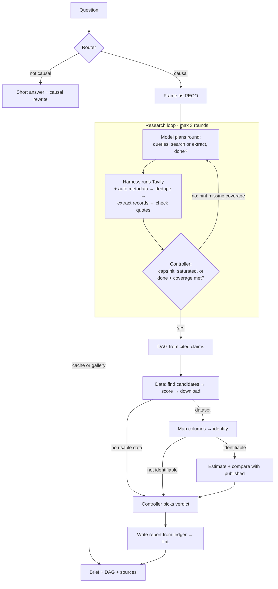

# Causal Genie — PRD v1.1 (lean MVP)

> 2026-11-01 · Owner: Shuangshuang Liu · Team: **Sample Size of One** (solo)
> Hackathon: [ODSC × Nebius](https://hackathon.odsc.ai/), **submissions close Fri Nov 20**. Required: **Nebius Token Factory** (models) and **Tavily** (search).
> Budget: 5–10 h/week ≈ **14–27 h** total. This plan is **≈ 19 h**, leaving room for overruns.
> Background (landscape, full v2 design, checklists, IP notes) and coding-agent rules are kept in local-only files that are not in this repo.

> [!WARNING]
> **TODO before making the repo public (by Nov 19):** this PRD contains private planning notes that must be reviewed and reworded or removed:
> - **Job fit:** "Product analyst (job fit)" in §3, and any other mention of job targets.
> - **Hackathon strategy:** "what judges must see" and the scoring weights in §2, "research quality is 45% of the score" in §5.3, and the "If behind, cut in order" list in §7.
> - **Personal planning:** the time budget and hours per task (header, §7), and the owner and team-name line.
> - **Local-only files:** remove the line above about local-only files.
> - Keep what helps readers: pitch, design, verdicts, data contracts, demos, eval and guardrails. Consider moving them into `docs/ARCHITECTURE.md`, or drop the PRD from the public repo in favor of the README.

---

## 1. Pitch

**Causal Genie is a research agent for "does X cause Y?" questions** (*"Does the full moon cause more births?"*). It:

1. researches the question like a mini systematic review and builds a **causal graph (DAG) whose arrows cite checked source passages**;
2. **finds and downloads a public dataset** with the treatment, the outcome and the confounders;
3. **computes** whether the effect can be identified from those columns;
4. **estimates the effect**, or **declines** and says what's missing and what study would settle it;
5. compares its own number with the published one when there is one.

**Core rule: the model proposes; the harness decides (controller) and computes (tools).** Every number comes from a tested tool; every claim links to a source passage or a computed result.

---

## 2. Success criteria

| Hackathon criterion | Weight | What judges must see |
|---|---|---|
| Sourced, verifiable answers | 30% | Click a claim → source passage; click a number → tool result; primary sources; conflicts shown; certainty label |
| Works end to end | 25% | Live run with real Token Factory + Tavily calls; graceful empty results and API failures |
| Usefulness | 20% | Clear decision: "Can I trust this causal claim, and what would settle it?" |
| Agent design | 15% | Hybrid research loop: the model plans each round (queries, `search` vs `extract`, proposed stop, a `why` per query) and the controller enforces caps and required coverage; disproving search, dedupe by study, evidence-flow counts |
| Token Factory + Tavily | 10% | Both essential and visible in the trace |

Submission: public repo · README · short demo video · no keys in the repo.

**Done means:**

| Check | Target |
|---|---|
| Demos D0, D1, D3, D4, D5 run end to end live; replay mode works without keys | 5/5 |
| Expected verdict on the eval set (§8) | ≥ 5/6 |
| Quotes actually found in the source | ≥ 90% |
| Numbers in the report not traceable to a tool result | **0** |
| Estimates produced when the design doesn't support one (D4) | **0** |
| RCT tool vs independent calculation (incl. a zero-event arm) | within 1e-4 |
| Synthetic data with known effect | true effect inside the 95% CI |
| Humor shown where the gate forbids it | **0** |

---

## 3. Users

| User | Example question | Decision supported |
|---|---|---|
| Curious person / judge | "Does the full moon cause more births?" | Myth or fact, and how sure we are |
| Product analyst (job fit) | "Did the new onboarding flow raise 7-day activation?" | Roll out, keep testing, or fix the data |
| Health / biostat analyst | "Does licorice gargling reduce post-op sore throat?" | What the evidence supports, for whom, how strongly |

Not medical, legal or financial advice; every report says so.

---

## 4. Lean MVP

| # | Capability | Lean version (what we build) |
|---|---|---|
| M1 | Frame | Question → `CausalQuery` as **PECO** (Population, Exposure, Comparator, Outcome) + estimand; one clarifying question if ambiguous |
| M2 | Route | cache / gallery replay / not causal / causal |
| M3 | Research | Query groups → Tavily → Europe PMC metadata → dedupe by study → one model call per source → citation checks → certainty label → evidence-flow counts (§5.3) |
| M4 | DAG | Built from claims; each edge cites a claim or is marked "assumed"; cycle check; rendered PNG + JSON |
| M5 | Data | Paper → data links + allowlisted search → rule filter → score top 10 → download top 1 (try next, ≤ 3) |
| M6 | Map + identify | Model suggests column ↔ node mapping, user confirms; derived variables (calendar, moon phase); DoWhy backdoor set; RCT detection; selection-after-assignment check; **recognizes DiD, IV and RDD setups** (named and explained, not estimated) |
| M7 | Estimate | **RCT:** risk difference + Newcombe CI, or mean difference + Welch CI. **Observational:** OLS/logistic adjustment, naive vs adjusted side by side |
| M8 | Verdict + report | Controller picks the verdict; report written only from ledger claims and tool results; lint; Genie aside behind the gate |
| M9 | Serve | Streamlit Community Cloud, replay by default; live mode behind a passcode and spend cap |
| M10 | Eval | 6 frozen cases + a no-tools baseline |

**Not in the MVP** (stretch/v2): risk-of-bias lite, full GRADE-lite, citation chasing, OpenAlex/Crossref, pooling, second-dataset replication, AIPW/bootstrap, E-value, refuters, overlap report, sample-ratio-mismatch test, power/MDE, D2 (NHEFS), estimating DiD/IV/RDD (MVP only recognizes them), MLflow, Cloud Run, myth mining, separate literature-first route.

---

## 5. Design

### 5.1 Architecture

| Part | What it is |
|---|---|
| **Model** | Token Factory: a small model for routing, per-source extraction, mapping, humor gate; a large one for the DAG and the report |
| **Controller** (harness) | Runs steps and loops, validates outputs against schemas, enforces budgets, picks the verdict, logs everything |
| **Tools** (harness) | Tested deterministic functions: search, metadata, download, profile, derive, identify, estimate, render |



Loops are bounded. **Research (hybrid):** each round the model returns a `ResearchPlan`: queries, a tool per query (`search` or `extract`), a `why` for each, and whether it thinks it's done. The harness runs the tools, adds metadata automatically, and decides: stop at 3 rounds, when a round adds < 2 new studies, or when the model says done **and** required coverage is met (disproving search run, a primary source for each key claim, a source for each DAG edge). If the model says done too early, the controller overrides and names what's missing in the next prompt. **Data:** try the next candidate, or re-search once naming the missing variable; ≤ 3 downloads. **Report:** one rewrite if lint fails, then the sentence is dropped.

### 5.2 Verdicts (picked by the controller, never by the model)

| Verdict | When |
|---|---|
| ✅ Estimated from data | Treatment, outcome and adjustment set (or randomized design) mapped to real columns |
| ⚠️ Estimated, strong assumptions | As above, but the literature names a confounder the data lacks |
| 📚 Published evidence only | Studies found and checked; no usable data |
| 🔒 Data restricted | Dataset sits in Vivli, YODA, BioLINCC, MIMIC, etc. |
| 🧪 Not estimated — study plan | Key confounder missing, selection after assignment, outcome mismatch, or a DiD/IV/RDD setup the MVP recognizes but doesn't estimate |
| ❓ Insufficient evidence | Sparse or contradictory search results |
| 🚫 Not causal | Router says it's descriptive |

### 5.3 Research method (the core; research quality is 45% of the score)

A scaled-down **systematic review**. Each step is a prompt + schema or a simple rule.

| Step | Lean MVP |
|---|---|
| **Frame** | PECO from `CausalQuery` drives every query and every include/exclude decision |
| **Plan each round** (model) | Round 1 covers every group: best existing answer (reviews first) · primary studies, incl. natural experiments (policy changes, staggered launches, thresholds) · mechanism · confounders · **evidence against the leading answer** · data availability. Lay + technical terms. ≤ 12 queries in round 1. Later rounds target what's missing, using the state summary (included studies, snippet-only sources, gaps, rounds left). Controller rejects a round-1 plan missing a group |
| **Search** | Tavily `search` (advanced) + `extract`, preferring PubMed, Europe PMC, Cochrane, NIH/CDC, NBER, medRxiv. News, blogs and Wikipedia are leads only: follow them to the paper or mark the claim "secondary only" |
| **Enrich** | Europe PMC: DOI, publication type, **retraction status** |
| **Dedupe by study** | Group by DOI/PMID, then fuzzy title + first author + year. Ten news stories about one paper = one study |
| **Extract (one call per source)** | Include/exclude with a reason code, plus a `Study` record with a verbatim quote for each key field |
| **Check citations** | Tool: fuzzy match confirms the quote is in the fetched text. Model: does the quote support the claim? Failures are dropped or marked unresolved |
| **Certainty** | Rule-based label, inspired by GRADE (§5.4) |
| **Evidence flow** | Counts shown in the report: found → after dedupe → included, with exclusion reasons (PRISMA-style) |

**Who decides in research:** the **model** writes query text, picks `search` or `extract` for each, and proposes when to stop. **Code** runs metadata on every new study (no judgment needed), dedupes, checks quotes, enforces caps and coverage, and makes the final stop decision. Tavily is the only search tool on the menu.

### 5.4 Certainty rule (controller)

Start at **High** if a meta-analysis or RCT matches PECO, **Low** if the best evidence is observational, **Very low** if it's only case reports or secondary sources. Go down one level if included studies point in different directions with no explanation, and one more if the best evidence is about a different population or exposure. Conflicts are explained, not averaged; no "7 studies say yes" vote counting.

### 5.5 Data contracts (Pydantic)

```python
class CausalQuery(BaseModel):
    population: str; exposure: Variable; comparator: str; outcome: Variable
    time_window: str | None
    # The whole CausalQuery is the estimand; these fields complete it.
    target: Literal["ATE", "ATT"]                    # average effect in everyone vs in the treated
    effect_scale: Literal["risk_difference", "risk_ratio", "odds_ratio", "mean_difference"]
    deviation_strategy: Literal["as_assigned", "as_received", "n/a"]  # ITT vs per-protocol; n/a if observational
    ambiguities: list[str]             # non-empty → one clarifying question

class Study(BaseModel):
    id: str; url: str; doi: str | None; pmid: str | None; title: str; year: int | None
    design: Literal["meta_analysis", "systematic_review", "RCT", "natural_experiment",
                    "cohort", "case_control", "cross_sectional", "case_report", "other"]
    strategy: Literal["randomization", "adjustment", "DiD", "IV", "RDD", "other", "unclear"]  # how the study identified its effect
    included: bool; exclusion_reason: str | None
    population: str; n: int | None; effect: str | None
    direction: Literal["+", "-", "null", "mixed", "unclear"]
    adjusted_for: list[str]            # feeds DAG confounders
    data_link: str | None              # feeds paper → data
    retracted: bool; secondary_only: bool
    quotes: dict[str, str]             # field → verbatim passage

class Query(BaseModel):
    text: str
    tool: Literal["search", "extract"]   # search = Tavily search; extract = Tavily extract (text = URL)
    why: str                             # logged in the research log; not used for control

class ResearchPlan(BaseModel):
    queries: list[Query]
    done: bool                           # a proposal; the controller makes the final call
    done_reason: str

class Claim(BaseModel):
    id: str; text: str
    kind: Literal["edge", "confounder", "effect_estimate", "null_result", "mechanism", "data_availability"]
    study_id: str | None; quote: str | None; result_id: str | None
    status: Literal["documented", "assumed", "inferred", "unresolved"]
    grounding: Literal["quote_found", "quote_not_found", "n/a"]
    support: Literal["supports", "partial", "contradicts", "irrelevant", "unchecked"]

class DagEdge(BaseModel):
    source: str; target: str; claim_ids: list[str]   # empty → "assumed"

class DatasetCandidate(BaseModel):
    url: str; host: str; license: str | None
    access: Literal["open", "restricted", "unknown"]
    coverage: dict[str, str | None]    # DAG node → column
    score: float | None; rejected_reason: str | None

class Result(BaseModel):
    id: str; tool: str; tool_version: str; inputs_hash: str; outputs: dict
```

The **claim ledger** is the list of `Claim`s; the report may only use ledger entries and `Result`s. `RunState` holds everything plus routing, token/cost/latency counters and versions, saved as JSON per run so any run can be replayed.

### 5.6 Data discovery

- **Sources:** data links from included studies first, then Tavily + repository search, both limited to the allowlist: Zenodo, Harvard Dataverse, Dryad, figshare, OSF, Rdatasets, ClinicalTrials.gov v2, and named GitHub repos only (FiveThirtyEight `data`, `medicaldata`). Restricted hosts (Vivli, YODA, BioLINCC, PhysioNet/MIMIC, UK Biobank) → 🔒, never downloaded.
- **Single table only in the MVP.** Multi-table datasets (e.g., NHANES, which also needs survey weights) are reported as candidates the MVP can't use yet, usually → ⚠️ or 📚. Safe joins are stretch work.
- **Screening:** rule filter (host, license, format, size, keywords; no tokens) → small model scores the top 10 on coverage of DAG nodes → download the top 1, next if it fails, ≤ 3. The eval logs the accepted dataset's rank so the top-10 cap can be checked.
- **Must-haves:** treatment, outcome and adjustment set covered · open license · matching population/period · single table · ≤ 50 MB.
- **Hard rules:** allowlist only · no private-network addresses · CSV/TSV/XLSX/Parquet/ZIP only · nothing executed from downloads · DOI, license, date and checksum recorded · downloads never committed · **finding a dataset never justifies an estimate on its own.**

### 5.7 Statistics tools

| Tool | Method | Validation |
|---|---|---|
| `identify` | DoWhy backdoor set | Textbook DAGs: confounder, mediator, collider, M-bias |
| `detect_design` | Randomized only if assignment is documented and in the data; flags selection after assignment (rows ≠ roster). **Recognizes, without estimating:** DiD (groups observed before and after a treatment start), IV (a variable that shifts treatment, with a cited reason it affects the outcome only through treatment), RDD (treatment set by a score crossing a cutoff). Returns the design, its key assumption, the effect it would identify (ATT / LATE / effect at the cutoff) and the check to run | Fixtures incl. completers-only export, staggered-launch panel, threshold-assigned data |
| `rct_effect` | Risk difference + Newcombe CI; mean difference + Welch CI | Independent calculation within 1e-4; zero-event arm |
| `backdoor_effect` | OLS/logistic adjustment with robust SEs; naive estimate alongside | Synthetic data with known effect |
| `derive` | Day of week, holidays, moon phase (`ephem`) | Spot-check vs published moon calendars |

### 5.8 Report and Genie mode

Sections: Verdict · Plain summary (≤ 120 words) · Question (PECO) · DAG · Key confounders · Evidence by study design + certainty + evidence-flow counts · Data used · Estimate *or* study plan (names any recognized DiD/IV/RDD design, its key assumption, what it would estimate and the check to run) · Comparison with published · Limitations · Sources · Run ID.
**Genie mode** (off by default): one labeled "🧞 Genie's aside", only for 📚/❓/🚫 or whimsical questions, never on sensitive topics; no numbers or new facts; always ends with the useful next step. The harness decides.

### 5.9 Failure handling

| Failure | Behavior |
|---|---|
| Search finds nothing useful | Reformulate once → ❓ listing what was searched |
| API timeout / rate limit | Backoff + one retry → partial report naming the failed step (never "no evidence exists") |
| Model output fails schema | One repair retry → logged error |
| Research plan fails schema | One repair retry → fallback plan: the preset query groups (the fixed loop) |
| Model says done too early | Controller overrides; the next prompt names the missing coverage |
| DAG cycle | Drop the weakest-evidence edge (logged) |
| No dataset / restricted | 📚 with rejected candidates / 🔒 with access steps |
| Selection after assignment | Withhold the estimate; ask for the full roster |

### 5.10 Stack and layout

Python 3.11 · **uv** · Pydantic v2 · `openai` client with `base_url` = Token Factory · `tavily-python` · DoWhy · statsmodels · networkx · graphviz · pandas/DuckDB · `ephem` · Streamlit · pytest · Ruff · ty · prek · GitHub Actions.

```
causal_genie/
  agent/   controller.py  state.py  router.py  steps/{frame,research,dag,data,identify,estimate,report}.py
  tools/   search.py  metadata.py  download.py  profile.py  derive.py  identify.py  stats.py  render.py
  llm/     client.py  models.yaml  prompts/*.md
  ui/app.py
eval/      cases.yaml  run_eval.py  baseline.py  results/
tests/     conftest.py  fixtures/
docs/      SYSTEM_CARD.md  DECISIONS.md
```

Env vars: `NEBIUS_API_KEY`, `NEBIUS_BASE_URL`, `TAVILY_API_KEY`, `GENIE_MODE`, `CG_REPLAY=1` (replay without keys).

---

## 6. Demos

| # | Question | Data | Verdict | Proves |
|---|---|---|---|---|
| **D0 hook** | "Does the full moon cause more births?" | FiveThirtyEight US daily births + moon phase from `derive` | ✅ | Data discovery, derived treatment, adjusting for weekday/holidays |
| **D1 RCT** | "Does licorice gargling reduce post-op sore throat?" | Paper → `medicaldata` trial data | ✅ | Paper → data route; re-analysis matches the paper |
| **D3 A/B** | "Did the new onboarding flow raise 7-day activation?" | Synthetic CSV, known effect | ✅ | Product analytics; true effect in CI |
| **D4 refusal** | Same, but only users who finished onboarding | Synthetic CSV | 🧪 | Detects selection after assignment; withholds the estimate |
| **D5 humor** | "Does cracking your knuckles cause arthritis?" | None usable | 📚 + 🧞 | Graceful no-data answer; humor gate |

Gallery (replay): full moon/births, sugar/hyperactivity, knuckle cracking, shaving/hair, carrots/night vision. Vaccines/autism is only a gate test.
**Video (3 min):** D0 live → click a citation and a number → evidence-flow counts → D4 refuses → D5 Genie → eval scorecard.

---

## 7. Build plan (≈ 19 h)

Build a thin end-to-end slice first (D1 by end of week 1), then deepen research.

| ID | Task | Est. | Done when |
|---|---|---|---|
| **Week 1 · Nov 1–8** | | **~6 h** | |
| T1 | uv project, Ruff, ty, pytest, prek, CI, `.env.example` | 1 h | CI green on an empty test |
| T2 | Smoke tests: Token Factory (pick small + large, check JSON output), Tavily | 0.5 h | Model IDs in `models.yaml` |
| T3 | Dataset audit: D0 and D1 data downloadable with needed columns | 1 h | `eval/cases.yaml` drafted |
| T4 | Schemas, run state, LLM client (tiers + repair retry), router | 1.5 h | Unit tests pass |
| T5 | **Thin slice D1:** few queries → paper → `medicaldata` → `rct_effect` → plain report | 2 h | D1 runs end to end; RCT tests pass |
| **Week 2 · Nov 9–15** | | **~8 h** | |
| T6 | Research method (§5.3–5.4): hybrid loop (`ResearchPlan`, tool menu, coverage check, override, fallback plan), Europe PMC, dedupe, per-source extraction, citation checks, certainty, evidence-flow counts | 3.5 h | D0/D1 key studies found; ≥ 90% quotes grounded; trace shows each round's plan and `why`; override and fallback tested |
| T7 | DAG step + render | 1 h | Edges cite claims; acyclic |
| T8 | Data discovery (§5.6) | 1.5 h | D0 and D1 data found automatically |
| T9 | Mapping, `derive`, `identify`, `detect_design` (incl. DiD/IV/RDD recognition), `backdoor_effect` | 2 h | Textbook DAG + synthetic tests pass; D4 flagged; DiD and RDD fixtures recognized |
| **Week 3 · Nov 16–20** | | **~5 h** | |
| T10 | Verdict logic, report writer + lint, Genie gate | 1 h | D0–D5 give expected verdicts |
| T11 | Streamlit + replay mode | 1 h | Works with `CG_REPLAY=1` |
| T12 | Eval + baseline + scorecard | 1 h | Per-case table in `eval/results/` |
| T13 | README, system card, deploy, video, make repo public, submit | 2 h | Submitted by Nov 19 |

**If behind, cut in order:** Genie polish → D3 → baseline → Streamlit (ship CLI + Markdown; video shows CLI).
**Never cut:** disproving query group, dedupe by study, citation checks, evidence-flow counts, `identify`, verdict gate, D0, D1, D4, replay mode.

---

## 8. Evaluation

**6 frozen cases:** D0, D1, D3, D4, D5, plus a sensitive-topic gate test. Each has: expected verdict, 2–5 key studies, forbidden conclusions. Tune prompts on 3 other questions only.

| Metric | How |
|---|---|
| Verdict match | Count out of 6 |
| Key-study recall | Hand-listed key studies found and included |
| Grounding | % quotes found in source; % judged supporting |
| Unsupported numbers / forbidden conclusions | Must be 0 |
| Disproving search ran | Every case |
| Design recognition | `detect_design` labels the DiD, IV and RDD fixtures correctly (unit tests) |
| Fixed vs hybrid loop | Key-study recall on the 6 cases, fallback plan only vs model-planned rounds. Keep whichever wins |
| Data rank | Rank of the accepted dataset among scored candidates |
| Cost and latency | Per run and per route |

**Baseline:** the same Token Factory model + Tavily, no tools ("answer with sources"). Compare verdicts, unsupported causal claims, invented numbers and key-study recall. This is the headline: what the research method and harness add. Report counts (5/6), not percentages; live and replay results reported separately.

---

## 9. Guardrails

Keys only in `.env` (gitignored) · uploaded rows never sent to a model (schema + summaries only) · web text and downloads are data, never instructions · no model-written code or SQL executed · downloaded data never committed · disclaimer on every report · run ID records model IDs, prompt hashes, queries and dataset checksums.
