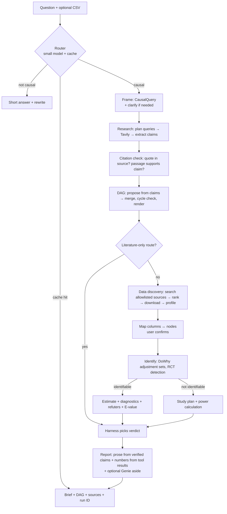

# Causal Genie — PRD v1.0 (ready for implementation)

> Status: **v1.0, ready to build** · 2026-11-01 · Owner: Shuangshuang Liu
> Hackathon: [ODSC × Nebius](https://hackathon.odsc.ai/). Build period Oct 28 – Nov 20, 2026. **Submissions close Fri Nov 20.** Required services: **Nebius Token Factory** (model calls) and **Tavily** (web search).
> Build budget: about **20 hours** (5–10 h/week), with Claude Code writing most of the implementation.
> Team: **Sample Size of One** (solo). The earlier draft PRD was retired; its strongest ideas are merged here (§14).

---

## 1. Pitch

**Causal Genie is a research agent for "does X cause Y?" questions.** Ask *"Does the full moon cause more births?"* or *"Does quitting smoking cause weight gain?"*. The agent:

1. searches the literature and builds a **causal graph (DAG) where every arrow cites a source passage**;
2. **finds and downloads a public dataset** that measures the treatment, the outcome, and the confounders;
3. **computes** (not guesses) whether the effect can be identified from those columns;
4. either **estimates the effect** with diagnostics, or **declines to estimate** and says what is missing and which experiment would answer the question;
5. if it found a published estimate, it **compares its own re-analysis with the paper's number**.

**Core rule:** the model proposes, the tools decide. Every number comes from a tested tool, and every claim links to a source passage or a computed result.

---

## 2. Success criteria

### 2.1 Hackathon (official weights)

| Criterion | Weight | What the judges must see | Where it's built |
|---|---|---|---|
| Sourced and verifiable answers | 30% | Click a claim → the source passage. Click a number → the tool result. Conflicting evidence shown, not hidden. | §6.3 claim ledger, §6.4 citation check |
| Works end to end | 25% | Live run: question → sourced answer with real Token Factory and Tavily calls. Sensible handling of empty results and API failures. | §6.1 pipeline, §6.8 failure table |
| Usefulness | 20% | A clear user and decision: "Can I trust this causal claim, and what would settle it?" | §3 users, §5 verdicts |
| Agent design | 15% | Query planning, evidence selection, explained tradeoffs, cost-aware routing | §6.2 routing, `DECISIONS.md` |
| Use of Token Factory + Tavily | 10% | Both clearly essential, visible in the trace | §6.6 models, §6.5 search |

Submission checklist: public repo · README (setup, how to run, architecture) · short demo video · no API keys in the repo.

### 2.2 Portfolio (Deloitte Sr Data Scientist first, FDE second)

| What the job asks for | How this project shows it |
|---|---|
| **Sr DS:** A/B test design and interpretation, control groups, measuring effect | RCT estimator (risk difference + Newcombe CI), sample-ratio-mismatch check, the "completers-only export" failure case, power calculation for proposed experiments |
| **Sr DS:** statistical rigor on complex data | Identification computed by tools, adjustment vs naive estimate, refutation tests, E-value, comparison with textbook/published answers |
| **Sr DS:** knowing when and how to apply AI/LLMs, and explaining that to the business | The "model proposes, tools decide" split, plus an eval showing where the model alone fails (baseline comparison) |
| **Sr DS:** turning data into clear narratives | The verdict-first brief: plain-language summary, then evidence, then technical appendix |
| **Sr DS:** taking ambiguous problems through to the end, independently | This PRD → build → eval → retrospective, with a decision log |
| **FDE:** turning GenAI use cases into working agentic systems | The agent itself, typed tool contracts, human-in-the-loop confirmation |
| **FDE:** tradeoffs among quality, safety, latency, cost | Model tiers, routing, budgets, measured cost and latency per route |
| **FDE:** production-quality code (testing, CI/CD, logging, versioning, docs) | pytest, GitHub Actions, structured run logs, versioned prompts, optional MLflow tracing |
| **FDE:** evaluation frameworks, monitoring, prompt management | Frozen eval set, baseline, MLflow add-on |

### 2.3 Release targets (what "done" means)

| Check | Target |
|---|---|
| Demo scenarios D0–D4 (§7) run end to end live | 5/5, plus replay mode works without keys |
| Expected verdict matched on the scored eval set (§9) | ≥ 7/10 |
| Claims whose quoted passage really appears in the source | ≥ 90% |
| Numbers in the report not traceable to a tool result | **0** |
| Estimates produced when the design doesn't support one (D4 and similar) | **0** |
| RCT tool matches an independent calculation | Within 1e-4 on fixtures, including a zero-event arm |
| Synthetic data with a known effect | True effect inside the 95% CI |
| All rendered DAGs acyclic | 100% |
| Humor shown where the gate forbids it | **0** |

---

## 3. Users and the main decision

| User | Question | Decision the brief supports |
|---|---|---|
| **Curious person / judge** (demo hook) | "Does the full moon cause more births?" | Myth or causal fact, and how sure we are |
| **Product analyst** (job fit) | "Did the new onboarding flow increase 7-day activation?" | Roll out, keep testing, or fix the data first |
| **Health / biostat analyst** | "Does quitting smoking cause weight gain?" | What the evidence supports, for which population, and how strong it is |

Out of scope: medical, legal, or financial advice. Every report carries a short disclaimer.

---

## 4. Scope

### 4.1 MVP (in the 20 hours)

| # | Capability |
|---|---|
| S1 | Question → structured `CausalQuery` (treatment, outcome, population, comparator, time window, estimand); one clarifying question if needed |
| S2 | Routing: cache / not-causal / literature-only / full pipeline (§6.2) |
| S3 | Literature research with Tavily → **claim ledger** with quoted passages and citation checks |
| S4 | DAG built from claims; every edge cites a claim or is marked "assumed"; rendered image + JSON |
| S5 | **Automatic dataset discovery and download** from allowlisted public sources (§6.5) |
| S6 | Column ↔ node mapping (model proposes, user confirms); derived-variable tools (calendar features, moon phase) |
| S7 | Identification computed by tools (DoWhy); randomized-design detection |
| S8 | Estimators: **RCT** (risk difference + Newcombe CI; difference in means for continuous outcomes) and **backdoor adjustment** (regression + AIPW) |
| S9 | Diagnostics: sample-ratio mismatch, positivity/overlap, placebo and random-common-cause refuters, E-value |
| S10 | Experiment design with power/sample size when the effect can't be identified |
| S11 | Verdict-first report (Markdown) + Streamlit page; Genie mode toggle |
| S12 | Eval harness: 10 frozen cases + baseline; replay mode from cached inputs |
| S13 | Public demo link: Streamlit Community Cloud, replay by default, live mode behind a passcode and budget cap (§6.8b) |

### 4.2 Optional add-ons (built so they can be switched on)
- **MLflow** tracing, run logging, eval runs (~2–3 h).
- **GCP Cloud Run** as an alternative host with Secret Manager (~2 h); a GCP talking point. The MVP host is Streamlit Community Cloud (§6.8b).
- **Automatic myth mining** from Wikipedia (~1–2 h); the MVP gallery is picked by hand.

### 4.3 Not in this build (future work)
Jev router (TypeSafe AI) · Databricks · IV/DiD/RDD estimation (named in plans only) · causal discovery from data (PC/GES) · EconML/DML · interactive DAG editor (JSON edit instead) · critic loop · near-duplicate semantic cache · multi-table joins.

---

## 5. Verdicts

The harness picks the verdict from tool results; the model never picks it.

| Verdict | Required evidence | Output |
|---|---|---|
| ✅ **Estimated from data** | Matching estimand; treatment, outcome, and a valid adjustment set (or randomized design) mapped to real columns; diagnostics pass | Effect, 95% CI, sample sizes, assumptions, robustness table, comparison with published estimate if any |
| ⚠️ **Estimated, with strong assumptions** | As above, but the literature names an unmeasured confounder, or diagnostics are borderline | Estimate + E-value + what would change the conclusion |
| 📚 **Published evidence only** | Relevant studies found and checked, but no usable data | Published results attributed to their authors and populations; how far they apply |
| 🔒 **Data exists but is restricted** | Dataset identified in a restricted repository (Vivli, YODA, BioLINCC, MIMIC) | Where it is and how to request access, plus 📚 output |
| 🧪 **Not identifiable — study plan** | Key confounder unmeasured, or selection after assignment, or outcome definition mismatch | The specific gap, likely confounders, and an experiment design with sample size |
| ❓ **Insufficient evidence** | Searches sparse or contradictory | Says so, lists what was searched, and suggests a next step |
| 🚫 **Not a causal question** | Router says it's descriptive | Short answer + a causal rewrite suggestion |

---

## 6. System design

### 6.1 Architecture

Vocabulary: the **harness** is everything around the model, and it has two parts.

| Part | What it is | Is it a model? |
|---|---|---|
| **Model** | Models on Nebius Token Factory: a small one for high-volume simple steps, a large one for the DAG and the report | Yes |
| **Harness → controller** | Runs steps and loops, holds typed run state, validates model output, enforces budgets and stop rules, picks the verdict, logs everything | No |
| **Harness → tools** | Tested deterministic functions: search, download, profile, identify, estimate, power, render | No |

Rule: **the model proposes; the harness decides (controller) and computes (tools).**



### 6.2 Routing and model tiers

| Route | Trigger | What runs |
|---|---|---|
| Cache hit | Exact match on normalized question + data hash | Return saved report, labeled "cached on <date>" |
| Not causal | Small-model classifier | Short answer + rewrite |
| Gallery myth | Matches a prepared card | Replay saved run (option to refresh live) |
| Literature-first | Classifier says data is unlikely (whimsical/abstract question) | Literature research + **one cheap data probe** (1 query, metadata only). Full data discovery only if the probe finds a promising candidate. Avoids skipping data that does exist. |
| Full | Everything else | All steps |

Model tiers are a config table (step → `small` or `large`). Small: routing, claim extraction, humor gate, column-mapping suggestions. Large: DAG proposal, report writing. The router sits behind a `Router` interface so a future Jev router can be swapped in.

### 6.3 Data contracts (Pydantic)

```python
class CausalQuery(BaseModel):
    treatment: Variable            # name, type, definition
    outcome: Variable
    comparator: str
    population: str
    time_window: str | None
    estimand: Literal["ATE", "ATT", "ITT", "risk_difference", "mean_difference"]
    ambiguities: list[str]         # non-empty → ask one clarifying question

class Source(BaseModel):
    id: str; url: str; title: str; retrieved_at: datetime
    study_design: Literal["RCT", "meta_analysis", "quasi_experimental", "observational", "review", "other"]
    population: str | None

class Claim(BaseModel):
    id: str
    text: str
    kind: Literal["edge", "confounder", "effect_estimate", "null_result", "mechanism", "data_availability"]
    source_id: str | None
    quote: str | None              # verbatim passage
    result_id: str | None          # for computed claims
    status: Literal["documented", "assumed", "inferred", "unresolved"]
    grounding: Literal["quote_found", "quote_not_found", "n/a"]
    support: Literal["supports", "partial", "contradicts", "irrelevant", "unchecked"]

class DagEdge(BaseModel):
    source: str; target: str
    claim_ids: list[str]           # empty → status "assumed"
    evidence_grade: Literal["A", "B", "C", "D"]   # RCT/meta · quasi-exp · observational · assumed

class DatasetCandidate(BaseModel):
    url: str; host: str; doi: str | None; license: str | None
    access: Literal["open", "restricted", "unknown"]
    files: list[str]; size_mb: float | None
    coverage: dict[str, str | None]   # DAG node → column (or None)
    rejected_reason: str | None

class Result(BaseModel):
    id: str; tool: str; tool_version: str
    inputs_hash: str; outputs: dict   # all numbers in the report come from here
```

`RunState` holds all of these plus routing decisions, token/cost/latency counters, and versions (model IDs, prompt hashes, dataset checksums). Stored as JSON per run (SQLite index), so any run can be replayed.

### 6.4 Research and citation checks

- Planner writes 4–8 queries in four groups: mechanism, confounders/selection, prior estimates (RCT, meta-analysis, natural experiment), data availability.
- Tavily `search` (advanced) → dedupe by study → `extract` full text for the top results. Domain preferences per field (e.g., pubmed, europepmc, nih.gov, cochrane.org, nber.org).
- Extraction (small model) produces `Claim`s with verbatim quotes.
- **Check 1 (tool):** fuzzy match confirms the quote exists in the fetched text.
- **Check 2 (model, different family if available):** does the quote support the claim?
- Failed claims are dropped or marked `unresolved`; the report shows the verification rate.
- Follow-up rounds are gap-driven and bounded (§6.8a).

### 6.5 Dataset discovery

Two routes, results merged and ranked:
1. **Paper → data:** follow data-availability links/DOIs found in sources (Zenodo, Dataverse, Dryad, GitHub).
2. **Direct search:** repository search APIs + Tavily queries built from node names, restricted to allowlisted hosts.

**MVP allowlist** (verify during the audit): FiveThirtyEight data (GitHub), `medicaldata` (GitHub), NHEFS (book site), Rdatasets (GitHub), Zenodo API, Harvard Dataverse API, CDC NHANES, ClinicalTrials.gov API v2 (summary results), raw.githubusercontent.com for these repos.
**Recognized but never downloaded:** Vivli, YODA, BioLINCC, PhysioNet/MIMIC → 🔒 verdict.

Steps: candidates → **read metadata only** (title, description, file list, license, size) → small model scores node coverage from metadata/headers/codebook → download top 1–3 → profile with DuckDB/pandas → mapping.

Hard rules (harness): allowlisted hosts only · no private-network addresses · ≤ 50 MB · CSV/TSV/XLSX/Parquet/ZIP only (safe unzip) · nothing executed from downloads · record DOI, license, retrieval date, checksum · downloaded data is never committed to git · **finding a dataset never justifies an estimate on its own.**

### 6.6 Statistics tools

| Tool | Method | Validation |
|---|---|---|
| `identify(dag, observed)` | DoWhy backdoor sets; frontdoor/IV flagged but not estimated | Unit tests on textbook DAGs (confounder, mediator, collider, M-bias) |
| `detect_design(profile, sources)` | Randomized if documented assignment + assignment column present | Fixtures |
| `rct_effect(df)` | Risk difference + **Newcombe** CI (binary); difference in means + Welch CI (continuous); **sample-ratio-mismatch** χ² test | Matches independent calculation within 1e-4; zero-event arm fixture |
| `backdoor_effect(df, adj)` | OLS/logistic adjustment + AIPW (DoWhy) with bootstrap CI; naive estimate reported alongside | Synthetic data with known effect; NHEFS textbook answer |
| `overlap(df, adj)` | Propensity distribution + trimming report | Fixtures |
| `refute(...)` | Placebo treatment, random common cause, data subset | DoWhy built-ins |
| `e_value(est, ci)` | VanderWeele–Ding E-value | Formula tests |
| `power(...)` | Two-proportion / two-mean sample size, MDE (statsmodels) | Compare against known tables |
| `derive(...)` | Calendar features (day of week, holidays), moon phase (`ephem`) | Spot-checked against published moon calendars |

### 6.7 Report and Genie mode

- Sections: Verdict · Plain-language summary (≤ 120 words) · The question (formal) · Causal graph · Key confounders and why · Evidence (by study design, with conflicts) · Data used (source, license, rows) · Estimate and diagnostics *or* study plan · Comparison with published estimates · Limitations · Sources · Run metadata.
- The model writes prose **only from verified claims**; numbers are inserted from `Result`s. A final lint rejects sentences with no claim or result reference.
- **Genie mode** (`professional` by default, `playful` toggle): one labeled line, "🧞 Genie's aside," allowed only when the verdict is 📚/❓/🚫 or the question is whimsical, **and** the topic isn't sensitive. The harness decides. The aside can't contain numbers or new facts, and it always ends by pointing to the useful next step.

### 6.8 Failure handling

| Failure | Behavior |
|---|---|
| Tavily returns nothing useful | Reformulate once; then ❓ with what was searched |
| API timeout / rate limit | Backoff + one retry; then partial report showing the failed step and a retry button (never "no evidence exists") |
| Model output fails schema | One repair retry; then safe default + logged warning |
| DAG has a cycle | Drop the weakest-evidence edge (logged) or ask the user |
| No dataset found / all rejected | 📚 with the list of rejected candidates and reasons |
| Restricted dataset | 🔒 with access instructions |
| Treatment or outcome not in columns | Study plan instead of estimate |
| Positivity violation | Trim, report rows dropped, downgrade to ⚠️ |
| Sample-ratio mismatch / selection after assignment | Withhold the estimate; name the missing roster |
| Sources contradict | Both shown; edge marked contested |

### 6.8a Iteration loops and stopping rules

Loops are **gap-driven**: the controller checks a fixed list of gaps and sends targeted follow-ups. There is no open-ended "review and improve your answer" step, because self-critique without new information adds little.

| Loop | Gap checks (controller) | Action |
|---|---|---|
| **Research** | No RCT or meta-analysis found · a confounder category missing (demographics, prior behavior, time trends, selection) · a DAG edge with no source · conflicting sources | Targeted queries for that gap only |
| **Data** | Best candidate lacks a confounder from the adjustment set · restricted access · wrong population or period | Next candidate, or a search that includes the missing variable |
| **Report** | Lint finds a sentence with no claim or result behind it | One rewrite; then the sentence is dropped |

**Stop when any of these is true:**
1. **Decisive evidence:** a meta-analysis/RCT answers the question, or a dataset meets every must-have.
2. **Saturation:** the last round added < 2 new unique studies or claims.
3. **Budget:** 3 research rounds, ~15 dataset candidates screened, 3 downloads, plus token and time caps.

**Choosing among many datasets ("good enough," not "best possible"):**
- *Must-haves:* treatment, outcome, and full adjustment set covered · open license · codebook · matching population and period · single table · ≤ 50 MB · enough rows to detect a meaningful effect (power check).
- *Ranking:* randomized design > observational, then coverage, sample size, documentation, recency.
- Screen metadata cheaply; download the top 1. Optionally analyze the runner-up as a **replication check** ("two independent datasets agree"), reported separately.

### 6.8b Serving (public link for judges)

| | Choice |
|---|---|
| Host | **Streamlit Community Cloud**, deployed from the GitHub repo; keys in its secrets settings. Alternative: GCP Cloud Run. |
| Default mode | **Replay**: saved runs of the demo and gallery questions, no API calls, so the link always works and costs nothing |
| Live mode | Behind a passcode; per-run limits and a daily spending cap; clear message when the cap is reached |
| Required anyway | Public repo + README + demo video (the hackathon's actual requirements) |

### 6.9 Stack and repo layout

Python 3.11 · plain-Python state machine · Pydantic v2 · `openai` client pointed at Token Factory · `tavily-python` · DoWhy · statsmodels · networkx · graphviz · DuckDB/pandas · `ephem` · Streamlit · pytest · ruff · GitHub Actions · optional MLflow.

```
causal_genie/
  agent/       controller.py  state.py  router.py  steps/{frame,research,verify,dag,data,map,identify,estimate,plan,report}.py
  tools/       search.py  repos.py  download.py  profile.py  derive.py  identify.py  stats.py  power.py  render.py
  llm/         client.py  models.yaml  prompts/*.md (versioned)
  obs.py       # logging; MLflow if enabled, otherwise no-op
  ui/app.py    # Streamlit
eval/          cases.yaml  reference_dags/  run_eval.py  baseline.py  results/
fixtures/      synthetic_onboarding.py  completers_only.csv  rct_zero_event.csv
docs/          ARCHITECTURE.md  DECISIONS.md  SYSTEM_CARD.md  RETRO.md
.env.example   README.md   pyproject.toml
```

Environment variables: `NEBIUS_API_KEY`, `NEBIUS_BASE_URL`, `TAVILY_API_KEY`, `GENIE_MODE`, `CAUSAL_GENIE_MLFLOW` (optional), `CG_REPLAY=1` (run from cache without keys).

---

## 7. Demo scenarios

| # | Question | Data | Expected verdict | What it proves |
|---|---|---|---|---|
| **D0 (hook)** | "Does the full moon cause more babies to be born?" | US daily births (FiveThirtyEight, from CDC/SSA) + moon phase computed by a tool | ✅ — report what the data says | Data discovery + derived treatment + adjusting for calendar effects (weekends, holidays); nature "randomizes" the moon |
| **D1 (medical RCT)** | "Does gargling licorice before surgery reduce post-op sore throat?" | Paper (PubMed) → trial data (`medicaldata`) | ✅ RCT path | Paper → data route; re-analysis matches the published result |
| **D2 (observational)** | "Does quitting smoking cause weight gain?" | NHEFS | ✅/⚠️ backdoor | Naive vs adjusted estimate; matches the textbook answer |
| **D3 (product A/B)** | "Did the new onboarding flow increase 7-day activation?" | Uploaded CSV (synthetic, known effect) | ✅ | Product analytics; true effect inside CI |
| **D4 (failure pair)** | Same as D3, export contains only users who *finished* onboarding | Uploaded CSV | 🧪 estimate withheld | Detects selection after assignment; asks for the full roster |
| **D5 (humor)** | "Does planting by the moon increase crop yield?" / "Does cracking your knuckles cause arthritis?" | Literature-first (data probe finds nothing usable) | 📚/❓ + 🧞 | Graceful no-data answer; humor gate |

**Gallery (hand-picked for MVP):** full moon/births, sugar/hyperactivity, knuckle cracking, shaving/hair thickness, carrots/night vision. Sensitive topics (e.g., vaccines/autism) are kept out of the gallery and used only as a gate test.

**Hackathon video (3 min):** D0 live (hook + data discovery) → click a citation and a number (verifiability) → D4 (refuses to estimate) → D5 with Genie aside → eval scorecard.

---

## 8. Build plan (≈ 23.5 hours)

| ID | Task | Est. | Done when |
|---|---|---|---|
| **Week 1 — Nov 1–7 (~7 h)** | | | |
| T1 | Repo, pyproject, `.env.example`, ruff, pytest, CI | 1 h | CI green on an empty test |
| T2 | Smoke tests: Token Factory (pick small + large model, check JSON output), Tavily search/extract | 0.5 h | Both return valid results; models recorded in `models.yaml` |
| T2b | **Landscape review (time-boxed):** read Causal-Copilot, causal-agent, PyWhy-LLM; decide what to reuse (§13.3) | 1 h | Reuse decisions in `DECISIONS.md` |
| T3 | **Dataset audit:** confirm D0, D1, D2 data can be downloaded and have the needed columns; write expected answers | 2 h | `eval/cases.yaml` drafted; swaps recorded |
| T4 | Schemas, run state, LLM client with tiers + repair retry, router | 1.5 h | Unit tests pass; router labels 15 sample questions sensibly |
| T5 | Frame + research + citation checks | 2 h | D1 produces a claim ledger with ≥ 90% grounded quotes |
| **Week 2 — Nov 8–14 (~8 h)** | | | |
| T6 | DAG step + render | 1.5 h | D0–D2 DAGs acyclic, edges cite claims |
| T7 | Data discovery + download + profile (allowlist) | 2.5 h | D0, D1, D2 data found and downloaded automatically |
| T8 | Mapping + derived variables + identify | 1.5 h | Correct adjustment sets on textbook DAG tests |
| T9 | Stats tools (RCT, backdoor, diagnostics, E-value, power) + fixtures | 2.5 h | Independent-calculation and synthetic tests pass |
| **Week 3 — Nov 15–20 (~7 h)** | | | |
| T10 | Verdict logic + report writer + lint | 1.5 h | D0–D5 produce correct verdicts |
| T11 | Streamlit page + Genie toggle + replay mode | 1.5 h | One command launches the demo; works with `CG_REPLAY=1` |
| T12 | Eval run + baseline + scorecard | 1.5 h | `eval/results/` with per-case table |
| T13 | README, system card, decision log, deploy to Streamlit Community Cloud (replay default), demo video, make repo public, submit | 3 h | Submitted before Nov 20; buffer on Nov 19 |
| *Optional* | MLflow (2–3 h) · Cloud Run (2 h) · myth mining (1–2 h) | | Only if T1–T13 are on track |

**If behind schedule, cut in this order:** D5 humor polish → Streamlit (ship CLI + Markdown) → baseline → D2 → direct repository search (keep paper → data + allowlisted known sources).
**Never cut:** citation checks, identify tool, verdict gate, D0, D1, D4, replay mode.

---

## 9. Evaluation plan

**Cases (frozen in `eval/cases.yaml` before prompt tuning):** 10 scored cases: D0–D5 plus 4 held out (one more myth with data, one more RCT, one restricted-data case, one sensitive-topic gate test). Develop prompts on 3 separate questions only. Each case has: expected verdict, key confounders, forbidden conclusions, expected sources/data.

| Layer | Metric |
|---|---|
| Routing | Correct route on ~30 labeled questions |
| Research | % quotes found in source; % supported (judge), with the judge checked against ~30 hand labels |
| DAG | Confounder recall vs your reference DAGs |
| Data discovery | Dataset found + downloaded where one exists; correct 🔒/📚 where not |
| Identification | Correct adjustment set / design |
| Estimation | Within CI of known truth (synthetic), matches published/textbook (D1, D2) |
| End to end | Verdict match; unsupported numbers = 0; forbidden conclusions = 0 |
| Stability | Each case run 3×; verdict agreement |
| Ops | Cost and latency per run and per route (median, max) |

**Baseline:** the same Token Factory model with Tavily, no tools ("answer this causal question with sources"). Count unsupported causal claims, wrong verdicts, and invented numbers. This is the headline result: what the harness adds.
**Optional extra baseline:** PyWhy-LLM's confounder suggestions vs ours, scored against the reference DAGs.
**Reporting:** counts (7/10), not percentages; per-case table with failure notes; live vs replay reported separately.

---

## 10. AI Engineering considerations (checklist)

| # | Consideration | Decision in this build |
|---|---|---|
| A1 | **Model/tool split** | Model proposes; tools compute; harness decides the verdict and inserts every number |
| A2 | **Structured outputs** | Pydantic schemas; JSON mode if Token Factory supports it for the chosen models; one repair retry |
| A3 | **Model selection and tiers** | Small model for high-volume steps, large for DAG/report; picked by a quick test on 5 examples, not leaderboards |
| A4 | **Routing for cost** | Cache, not-causal, literature-only, full; per-route cost logged |
| A5 | **Grounding and hallucination control** | Quote-in-source check + support check; claims without sources marked "assumed"; report lint |
| A6 | **Retrieval quality** | Query plan by evidence type; domain preferences; dedupe by study; max 3 rounds |
| A7 | **Prompt management** | Prompts as versioned files; hash logged per run; eval rerun when they change |
| A8 | **Evaluation** | Frozen cases, layered metrics, baseline, judge checked against hand labels, 3× runs |
| A9 | **Reproducibility** | Run state saved as JSON; cached tool inputs; replay mode without keys |
| A10 | **Observability** | Structured logs per step (tokens, latency, cost, status); MLflow tracing optional |
| A11 | **Failure handling** | Timeouts, backoff, one retry, partial reports that name the failed step |
| A12 | **Security** | Web text and downloads treated as data, never instructions; host allowlist; no private-network fetches; no model-written code/SQL executed; keys only in `.env` |
| A13 | **Privacy** | Uploaded rows never sent to a model; only column names, summaries, codebooks |
| A14 | **Human in the loop** | User confirms question framing and column mapping; DAG editable as JSON |
| A15 | **Cost and latency budgets** | Per-run caps on searches and tokens; target < 2 min and < $0.50 per full run (check against real numbers) |
| A16 | **Testing and CI** | Unit tests for every stats tool; fixture-based end-to-end test in replay mode in CI |
| A17 | **Portability** | OpenAI-compatible client; changing provider or model is a config change |

## 11. Data Science / statistics considerations (checklist)

| # | Consideration | Decision in this build |
|---|---|---|
| S1 | **Define the estimand first** | Population, treatment, comparator, outcome, time window, ITT vs per-protocol, before any data |
| S2 | **Identification before estimation** | DoWhy backdoor computation on the confirmed DAG; no estimate without it |
| S3 | **Randomized vs observational** | Separate paths; randomized only if assignment is documented and present in the data |
| S4 | **Selection after assignment** | Detected via roster vs analysis-row checks (D4); estimate withheld |
| S5 | **Sample-ratio mismatch** | χ² test against planned allocation |
| S6 | **Confounding** | Adjustment sets from the DAG; naive vs adjusted shown side by side |
| S7 | **Bad controls** | Don't adjust for mediators or colliders (post-treatment variables); tests on textbook DAGs |
| S8 | **Positivity/overlap** | Propensity plot; trimming reported |
| S9 | **Uncertainty** | CIs everywhere (Newcombe for proportions, bootstrap for AIPW); no bare point estimates |
| S10 | **Sensitivity to unmeasured confounding** | E-value; refuters (placebo, random common cause, subset) |
| S11 | **Measurement and outcome definitions** | Outcome definition compared between source and data; missing ≠ zero unless tracking is verified |
| S12 | **External validity (transportability)** | Report states which population each result applies to |
| S13 | **Multiple comparisons / forking paths** | One pre-specified primary analysis per case; the rest labeled exploratory |
| S14 | **Power and experiment design** | Sample size / MDE for proposed experiments; stratify on DAG confounders; CUPED mentioned when pre-period data exists |
| S15 | **Evidence hierarchy** | Meta-analyses/RCTs > quasi-experimental > observational > assumed; graded on DAG edges |
| S16 | **Validation against known truth** | Synthetic data, textbook (NHEFS), published estimate (D1) |
| S17 | **Communicating results** | Verdict first, plain language, limits stated, "analysis support, not a decision" |

## 12. Governance

| Area | Control |
|---|---|
| Data privacy | Uploaded rows stay local; models see only schema + summaries |
| Licensing and provenance | DOI, license, date, checksum per dataset; no downloaded data in the repo |
| Prompt injection | Source text is data; allowlist; typed tool arguments only |
| Overclaiming causality | Verdict chosen by tools; assumptions section required; E-value |
| Sensitive topics | Stricter template, no humor, disclaimer |
| Audit trail | Run ID with model IDs, prompt hashes, queries, dataset hashes, tool versions |
| Change control | Eval reruns on prompt/model changes; `DECISIONS.md` |
| Documentation | `SYSTEM_CARD.md`: intended use, out-of-scope uses, failure modes, eval results, third-party services |
| Interview framing | Model risk management (e.g., SR 11-7): conceptual soundness → identification + assumptions; monitoring → traces + evals; outcome analysis → comparison with published estimates |

---

## 13. Landscape and how Causal Genie stands out

### 13.1 Similar projects

| Project | What it does | Data | Literature + citations | Dataset discovery | Gap Causal Genie fills |
|---|---|---|---|---|---|
| [Causal-Copilot](https://github.com/Lancelot39/Causal-Copilot) ([paper](https://arxiv.org/abs/2504.13263)) | Autonomous causal analysis: 20+ discovery algorithms, DoWhy/EconML inference, PDF report. MIT, ~200 stars. | User uploads | No | No | Starts from a question, not a dataset; grounds the graph in literature |
| [Causal AI Scientist / causal-agent](https://github.com/causalNLP/causal-agent) ([docs](https://causal-agent.readthedocs.io/en/latest/)) | Natural-language causal query + user dataset → picks a method (RCT, DiD, IV, RDD, PS), runs diagnostics | User uploads, user names treatment/outcome | No | No | Finds the data and the confounders itself; builds a DAG |
| [CausalAgent (DMIRLAB)](https://github.com/DMIRLAB-Group/CausalAgent) | LangGraph multi-agent; causal discovery (PC, FCI) via MCP tools; report | User uploads | No | No | Same as above |
| [PyWhy-LLM](https://github.com/py-why/pywhyllm) | Library: LLM suggests confounders, edges, backdoor sets, IVs; experimental | n/a | No (CauseNet RAG) | No | Citations per edge; end-to-end agent; usable as our baseline |
| [EpiCausalX](https://www.medrxiv.org/content/10.64898/2026.02.06.26345723v1.full) (medRxiv preprint, 2026) | Searches 7 literature databases, builds an epidemiology DAG, scores evidence with Hill's criteria | **No data analysis**; effect sizes taken from papers | Yes | No | Re-analyzes real data; quantitative evaluation (theirs reports none); open source |
| [CausalDS benchmark](https://arxiv.org/abs/2607.08093) (2026) | Benchmark for data-science agents, including **abstention** when an effect isn't identified | Synthetic | — | — | Shows abstention is a recognized evaluation target, which our verdict gate addresses |
| [Agentic causal discovery benchmark](https://arxiv.org/abs/2610.22846) (2026) | Finds LLMs can get cause-effect directions from variable **names alone** (memorization) | — | — | — | Supports our design: claims must trace to retrieved passages, not model memory |

### 13.2 What makes Causal Genie different

1. **Question → evidence → data → estimate in one loop.** Existing agents either analyze a dataset you give them (Causal-Copilot, causal-agent, CausalAgent) or summarize literature without touching data (EpiCausalX). None found and downloaded a dataset for the question.
2. **Every DAG arrow cites a checked passage.** PyWhy-LLM and the analysis agents propose graphs from model knowledge; here each edge is either cited and verified, or visibly "assumed."
3. **Knowing when not to answer, as a feature.** Seven verdicts, chosen by tools, with a refusal case (D4) in the demo and abstention measured in the eval.
4. **Re-analysis vs published result.** The agent checks its number against the paper's or textbook's. That shows trustworthiness directly.
5. **Measured against a baseline.** Most projects show demos; this one shows how many unsupported causal claims a tool-less agent makes on the same questions.
6. **Relatable entry point.** Everyday myths with real data (full moon → births) plus Genie humor, then serious biostatistics and product A/B cases underneath.
7. **Built like a product.** Replay mode, system card, decision log, cost per route, optional MLflow.

Talking point: *"The closest projects either assume you already have the right dataset or stop at the literature. Causal Genie goes from a question to the right data and back to the literature, and it tells you when the honest answer is 'we can't know from this.'"*

### 13.3 Reuse plan (all MIT-licensed, checked 2026-11-01)

| Repo | License / activity | Reuse | How |
|---|---|---|---|
| [DoWhy](https://github.com/py-why/dowhy) | MIT · ~8.4k stars · active | **Core dependency** for identification, estimation, refuters | `pip` dependency |
| [PyWhy-LLM](https://github.com/py-why/pywhyllm) | MIT · ~300 stars · active | **Baseline** for confounder suggestions in the eval; read its prompts for ideas | Dependency in `eval/` only |
| [causal-agent (CAIS)](https://github.com/causalNLP/causal-agent) | MIT · active | Reference for its method-selection decision tree (RCT/DiD/IV/RDD/PS) when writing `detect_design` and the "future estimators" plan | Read; cite in `DECISIONS.md`; copy nothing without attribution |
| [Causal-Copilot](https://github.com/Lancelot39/Causal-Copilot) | MIT · ~200 stars | Reference for report structure and its simulation of synthetic data with known graphs (for eval fixtures) | Read; reuse ideas, attribute if code is adapted |
| [CausalAgent (DMIRLAB)](https://github.com/DMIRLAB-Group/CausalAgent) | MIT · less active | Low priority: its MCP tool wrapping of causal algorithms is an idea for future work | Skim only |
| [CausalDS](https://arxiv.org/abs/2607.08093) benchmark | Check whether data is released | If released, borrow 2–3 abstention cases for the held-out eval | Cite |

Rules: use libraries as dependencies rather than forking; if any code is adapted, keep the original MIT copyright notice in a `THIRD_PARTY_NOTICES.md`; credit all of them in the README's "Related work" section (it also shows judges you know the field).

---

## 14. What was merged from the earlier draft PRD (retired)

Kept from it: verdict-first brief and decision framing · claim status (documented / assumed / inferred / unresolved) · paired failure run (completers-only export) · Newcombe interval and sample-ratio-mismatch check · zero-event fixture · replay labeled separately from live runs · source text treated as untrusted · stop rules for the research loop · prohibition on model-written SQL/shell.
Changed: broader estimators (RCT + backdoor), automatic data discovery, myths/biostat demos, 10 cases instead of 12 to fit 20 hours.

---

## 15. Decisions log (open questions resolved 2026-11-01)

| Question | Decision |
|---|---|
| Token Factory models and budget | Pick small + large models in T2 by a 5-example test; cap ~$0.50/run |
| Gallery myths | Default five for now; swap any that fail the audit |
| GitHub | Private repo now, named `causal-genie`; public by Nov 19. License: **Apache-2.0** (or MIT). |
| PRD | This file is the only PRD |
| Team name | Sample Size of One |
| IP | See §16 |

## 16. IP and publishing (not legal advice)

1. **Employer agreement first.** Check your employment contract for an invention-assignment / outside-work clause. Build on personal time, personal laptop, personal accounts and API keys, with no employer code or data. If the project is close to your employer's business, ask HR or legal before going public.
2. **Hackathon terms.** Read the ODSC submission terms for IP ownership and any license granted to the organizers; the public repo is required anyway.
3. **Prior art and authorship.** A public GitHub repo with dated commits already records authorship. No arXiv preprint is needed before going public.
4. **Patents.** Public disclosure starts a 1-year US grace period and ends patent options in most other countries. Only matters if you'd want a patent, which is uncommon for a portfolio project like this.
5. **License.** Apache-2.0 includes an explicit patent grant; MIT is simpler. Either is fine for a portfolio.
6. **Third-party content.** Keep the MIT notices for any adapted code; don't commit downloaded datasets; follow each dataset's license; attribute Wikipedia (CC BY-SA) for gallery text.
7. **Optional writing after Nov 20:** a blog post or short arXiv technical report with the eval results (first-time arXiv submitters may need an endorsement).

---

## Appendix A. MLflow add-on (optional, 2–3 h)

All logging goes through `obs.py`. Without MLflow installed or `CAUSAL_GENIE_MLFLOW=1`, it writes JSON run logs only.

| Recorded | How |
|---|---|
| Traces of every model and tool call | MLflow tracing (OpenAI autolog works with Token Factory's OpenAI-compatible API; `@mlflow.trace` on steps and tools) |
| One run per question | Params: model IDs, prompt hashes, route. Metrics: cost, latency, % grounded. Artifacts: report, DAG, dataset manifest |
| Eval runs | `run_eval.py` logs per-case scores to an MLflow experiment, to compare prompt and model versions |

Confirm current MLflow 3 API names on install; fall back to `log_param` / `log_metric` / `log_artifact`.

## Appendix B. Genie mode examples

> 🧞 *"Your wish is my command, but the data gods have not spoken. I found zero randomized trials of planting by the moon. I can design one for you: 2 groups of plots, matched on soil, one season."*
>
> 🧞 *"One man cracked the knuckles of one hand for 60 years and checked. That's a sample size of one, and a very dedicated one. Here's what the larger studies say..."*

Gate (harness): verdict ∈ {📚, ❓, 🚫} or whimsical question · not a sensitive topic (asymmetric threshold: any reasonable chance of "sensitive" blocks humor) · `GENIE_MODE=playful`. Asides contain no numbers or new facts.

## Appendix C. Cloud decisions

- **GCP Cloud Run** (optional): hosted demo, keys in Secret Manager, rate-limited or replay-only for public use.
- **Databricks:** not in this build. MLflow is the transferable skill. After Nov 20, pointing MLflow at Databricks Free Edition is a configuration change if FDE roles become a priority.
- **Jev (TypeSafe AI):** future router option behind the `Router` interface; left out because of early-access status, self-reported claims, and the hackathon's Token Factory weighting.

---

## Sources

Hackathon: [hackathon.odsc.ai](https://hackathon.odsc.ai/) · Jobs: [Deloitte Sr Data Scientist (369367)](https://apply.deloitte.com/en_US/careers/JobDetail/Sr-Data-Scientist/369367), [Deloitte FDE – Databricks (350624)](https://apply.deloitte.com/en_US/careers/JobDetail/Forward-Deployed-Engineer-Databricks/350624) · Landscape: links in §13.1.
