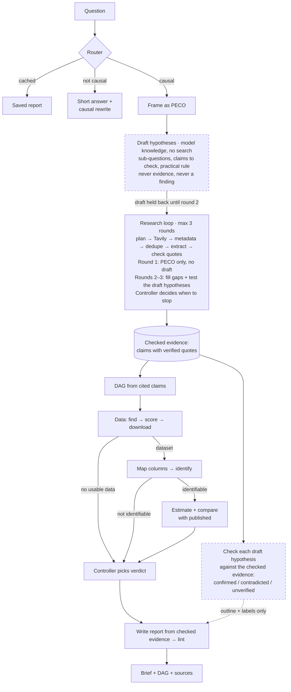

# Causal Genie — PRD v1.1 (lean MVP)

> Built for the [ODSC × Nebius hackathon](https://hackathon.odsc.ai/). Uses **Nebius Token Factory** (models) and **Tavily** (search).

---

## 1. Pitch

**Causal Genie is a research agent for "does X cause Y?" questions** (*"Does the full moon cause more births?"*). It:

1. researches the question like a mini systematic review and builds a **causal graph (DAG) whose arrows cite checked source passages**;
2. **finds and downloads a public dataset** with the treatment, the outcome and the confounders;
3. **computes** whether the effect can be identified from those columns;
4. **estimates the effect**, or **declines** and says what's missing and what study would settle it;
5. compares its own number with the published one when there is one.

**Core rule: the model proposes; the harness decides (controller) and computes (tools).** Every number comes from a tested tool; every claim links to a source passage or a computed result.

---

## 2. Success criteria

| Goal | What the app must show |
|---|---|
| Sourced, verifiable answers | Click a claim → source passage; click a number → tool result; primary sources; conflicts shown; certainty label |
| Works end to end | Live run with real Token Factory + Tavily calls; graceful empty results and API failures |
| Usefulness | Clear decision: "Can I trust this causal claim, and what would settle it?" |
| Agent design | Hybrid research loop: the model plans each round (queries, `search` vs `extract`, proposed stop, a `why` per query) and the controller enforces caps and required coverage; disproving search, dedupe by study, evidence-flow counts |
| Token Factory + Tavily | Both essential and visible in the trace |

Deliverables: public repo · README · short demo video · no keys in the repo.

**Done means:**

| Check | Target |
|---|---|
| Demos D0, D1, D3, D4, D5 run end to end live; replay mode works without keys | 5/5 |
| Expected verdict on the eval set (§8) | ≥ 5/6 |
| Quotes actually found in the source | ≥ 90% |
| Numbers in the report not traceable to a tool result | **0** |
| Estimates produced when the design doesn't support one (D4) | **0** |
| RCT tool vs independent calculation (incl. a zero-event arm) | within 1e-4 |
| Synthetic data with known effect | true effect inside the 95% CI |
| Humor shown where the gate forbids it | **0** |

---

## 3. Users

| User | Example question | Decision supported |
|---|---|---|
| Curious person | "Does the full moon cause more births?" | Myth or fact, and how sure we are |
| Product analyst | "Did the new onboarding flow raise 7-day activation?" | Roll out, keep testing, or fix the data |
| Health / biostat analyst | "Does licorice gargling reduce post-op sore throat?" | What the evidence supports, for whom, how strongly |

Not medical, legal or financial advice; every report says so.

---

## 4. Lean MVP

| # | Capability | Lean version (what we build) |
|---|---|---|
| M1 | Frame | Question → `CausalQuery` as **PECO** (Population, Exposure, Comparator, Outcome) + estimand; up to 3 clarifying questions in one turn if ambiguous, then one reframe |
| M2 | Route | cache / gallery replay / not causal / causal |
| M3 | Research | Query groups → Tavily → Europe PMC metadata → dedupe by study → one model call per source → citation checks → certainty label → evidence-flow counts (§5.3) |
| M4 | DAG | Built from claims; each edge cites a claim or is marked "assumed"; cycle check; rendered PNG + JSON |
| M5 | Data | Paper → data links + allowlisted search → rule filter → score top 10 → download top 1 (try next, ≤ 3) |
| M6 | Map + identify | Model suggests column ↔ node mapping, user confirms; derived variables (calendar, moon phase); DoWhy backdoor set; RCT detection; selection-after-assignment check; **recognizes DiD, IV and RDD setups** (named and explained, not estimated) |
| M7 | Estimate | **RCT:** risk difference + Newcombe CI, or mean difference + Welch CI. **Observational:** OLS/logistic adjustment, naive vs adjusted side by side |
| M8 | Verdict + report | Controller picks the verdict; report written only from checked evidence and tool results; lint; Genie aside behind the gate |
| M9 | Serve | Streamlit Community Cloud, replay by default; live mode behind a passcode and spend cap |
| M10 | Eval | 6 frozen cases + a no-tools baseline |

**Not in the MVP** (stretch/v2): risk-of-bias lite, full GRADE-lite, citation chasing, OpenAlex/Crossref, pooling, second-dataset replication, AIPW/bootstrap, E-value, refuters, overlap report, sample-ratio-mismatch test, power/MDE, D2 (NHEFS), estimating DiD/IV/RDD (MVP only recognizes them), MLflow, Cloud Run, myth mining, separate literature-first route.

---

## 5. Design

### 5.1 Architecture

| Part | What it is |
|---|---|
| **Model** | Token Factory: a small model for routing, per-source extraction, mapping; a large one for the DAG, the report and the humor gate; a `draft` tier for the draft hypotheses (set to the large model; switchable in `models.yaml` if a different model wins the draft test in §8) |
| **Controller** (harness) | Runs steps and loops, validates outputs against schemas, enforces budgets, picks the verdict, logs everything |
| **Tools** (harness) | Tested deterministic functions: search, metadata, download, profile, derive, identify, estimate, render |



Loops are bounded. **Research (hybrid):** each round the model returns a `ResearchPlan`: queries, a tool per query (`search` or `extract`), a `why` for each, and whether it thinks it's done. The harness runs the tools, adds metadata automatically, and decides: stop at 3 rounds, after round 1 when no required coverage is missing, when a later round adds < 5 new studies, or when the model says done **and** required coverage is met (disproving search run, a primary source for each key claim, and, when sources were found but none studies the link itself, a round that searches each side on its own: what causes the outcome, what drives the exposure; and, with a draft, every draft sub-question covered by at least one included study, judged by word overlap between the sub-question and the study's title and effect, no model call. An uncovered sub-question forces one more round, within the 3-round cap). Edges don't exist until the DAG step, so "a source for each DAG edge" is checked there: an uncited edge sends research back for one more round if rounds are left, otherwise the edge is marked "assumed". If the model says done too early, the controller overrides and names what's missing in the next prompt. **Data:** try the next candidate, or re-search once naming the missing variable; ≤ 3 downloads. **Report:** one rewrite if lint fails, then the sentence is dropped.

### 5.2 Verdicts (picked by the controller, never by the model)

| Verdict | When |
|---|---|
| ✅ Estimated from data | Treatment, outcome and adjustment set (or randomized design) mapped to real columns |
| ⚠️ Estimated, strong assumptions | As above, but the literature names a confounder the data lacks |
| 📚 Published evidence only | Studies found and checked; no usable data |
| 🔒 Data restricted | Dataset sits in Vivli, YODA, BioLINCC, MIMIC, etc. |
| 🧪 Not estimated — study plan | Key confounder missing, selection after assignment, outcome mismatch, or a DiD/IV/RDD setup the MVP recognizes but doesn't estimate |
| 🔀 Explained by a common cause | No included trial or observational study of the exposure and outcome, and the DAG has a node with paths of checked citations to both (a link nobody studies because it is spurious, e.g. ice cream sales and shark bites) |
| ❓ Insufficient evidence | Sparse or contradictory search results |
| 🚫 Not causal | Router says it's descriptive |

### 5.3 Research method (the core)

A scaled-down **systematic review**. Each step is a prompt + schema or a simple rule.

| Step | Lean MVP |
|---|---|
| **Frame** | PECO from `CausalQuery` drives every query and every include/exclude decision |
| **Draft hypotheses** (`draft` tier, no search) | **Hypotheses only.** The model writes down what it already believes, as a `DraftAnswer`: the sub-questions the question really contains (e.g. "does each item cost less?" vs "do you spend less in total?"), short claims to check, tagged `main` / `exception` / `mechanism` / `caveat` (with any numbers it believes), and a candidate practical rule. These are things to test, like a review protocol's hypotheses, not evidence: a draft claim is not a checked-evidence `Claim`, is never cited, never counts toward certainty, the DAG or the verdict, and never appears in the findings in its own words or with its own numbers. It only shapes which searches run (from round 2) and how the summary is organized. **Bias guards:** (1) the draft never reaches extraction, quote checks, `check_support` on checked claims, the DAG, certainty or the verdict (tested on their prompt inputs); (2) round 1 is planned from PECO only, as without a draft, so research finds at least what it found before; the draft adds targeted queries from round 2 on, worded neutrally (the topic, not the draft's conclusion); (3) a wrong-draft test (main claim negated) must leave the verdict and the set of confirmed checked claims unchanged |
| **Plan each round** (model) | Round 1 covers every group: best existing answer (reviews first) · primary studies, incl. natural experiments (policy changes, staggered launches, thresholds) · mechanism · confounders · **evidence against the leading answer** · data availability. Round 1 does not see the draft. From round 2, the plan also sees the draft's sub-questions and claims: it covers each sub-question no included study covers yet and runs at least one query against the draft's `main` claim, so research cannot just confirm the draft. An uncovered sub-question is missing coverage (§5.1), so research cannot stop after round 1 while one remains. Lay + technical terms. ≤ 12 queries in round 1, ≤ 6 in later rounds (Tavily credit budget). Later rounds target what's missing, using the state summary (included studies, snippet-only sources, gaps, rounds left). Controller rejects a round-1 plan missing a group |
| **Search** | Tavily `search` (advanced) + `extract`, preferring PubMed, Europe PMC, Cochrane, NIH/CDC, NBER, medRxiv. News, blogs and Wikipedia are leads only: follow them to the paper or mark the claim "secondary only" |
| **Enrich** | Europe PMC: DOI, publication type, **retraction status** |
| **Dedupe by study** | Group by DOI/PMID, then fuzzy title + first author + year. Ten news stories about one paper = one study |
| **Extract (one call per source)** | Include/exclude with a reason code, plus a `Study` record with a verbatim quote for each key field |
| **Check citations** | Tool: fuzzy match confirms the quote is in the fetched text. Model: does the quote support the claim? Failures are dropped or marked unresolved |
| **Check draft** | Tests each hypothesis against the evidence; the evidence, not the hypothesis, is what the report states. Model proposes, for each draft claim, which checked claims bear on it; the harness keeps only `documented` checked claims, runs `check_support` on each (draft claim, quote) pair, one pair per call and without saying the claim came from a draft (a quote on a related point is not support), and sets the status: `confirmed` (a quote supports it), `contradicted` (a quote contradicts it; contradiction wins over support) or `unverified` (nothing checked bears on it) |
| **Certainty** | Rule-based label, inspired by GRADE (§5.4) |
| **Evidence flow** | Counts shown in the report: found → after dedupe → included, with exclusion reasons (PRISMA-style) |

**Who decides in research:** the **model** writes query text, picks `search` or `extract` for each, and proposes when to stop. **Code** runs metadata on every new study (no judgment needed), dedupes, checks quotes, enforces caps and coverage, and makes the final stop decision. Tavily is the only search tool on the menu.

> **Decided: Tavily `include_domains`.** Research queries use `include_domains_mode="prefer"` with the preferred sources above (not `"restrict"`, which would cut leads, the disproving search and journal sites); the replay key is query + domains. Data queries (§5.6) will use `"restrict"` with hosts from `download.ALLOWLIST`; Tavily filters by domain only, so `download.py` keeps the path checks (e.g. named GitHub repos).

### 5.4 Certainty rule (controller)

Start at **High** if a meta-analysis or RCT matches PECO, **Low** if the best evidence is observational, **Very low** if it's only case reports or secondary sources. Go down one level if included studies point in different directions with no explanation, and one more if the best evidence is about a different population or exposure. Conflicts are explained, not averaged; no "7 studies say yes" vote counting.

### 5.5 Data contracts (Pydantic)

```python
class CausalQuery(BaseModel):
    population: str; exposure: Variable; comparator: str; outcome: Variable
    time_window: str | None
    # The whole CausalQuery is the estimand; these fields complete it.
    target: Literal["ATE", "ATT"]                    # average effect in everyone vs in the treated
    effect_scale: Literal["risk_difference", "risk_ratio", "odds_ratio", "mean_difference"]
    deviation_strategy: Literal["as_assigned", "as_received", "n/a"]  # ITT vs per-protocol; n/a if observational
    ambiguities: list[str]             # non-empty → up to 3 clarifying questions in one turn

class Extraction(BaseModel):           # model output, one call per source
    source_kind: Literal["paper", "secondary"]   # secondary = news/blog/wiki about someone else's study
    included: bool
    exclusion_reason: Literal["off_topic", "wrong_population", "wrong_exposure",
                              "wrong_outcome", "not_a_study"] | None
    peco_match: Literal["direct", "indirect"]    # indirect lowers certainty
    title, first_author, year, design, strategy, population, n, effect, direction,
    adjusted_for, data_link                      # as in Study
    quotes: list[Quote]                          # {field, verbatim text} per filled-in key field

class Study(BaseModel):               # built by the harness from an Extraction + Europe PMC
    id: str; url: str; doi: str | None; pmid: str | None; title: str
    first_author: str | None; year: int | None     # first_author: used to dedupe
    design: Literal["meta_analysis", "systematic_review", "RCT", "natural_experiment",
                    "cohort", "case_control", "cross_sectional", "case_report", "other"]
    strategy: Literal["randomization", "adjustment", "DiD", "IV", "RDD", "other", "unclear"]  # how the study identified its effect
    included: bool; exclusion_reason: ExclusionReason | None   # model's codes + "retracted" (harness)
    peco_match: Literal["direct", "indirect"]
    population: str; n: int | None; effect: str | None
    direction: Literal["+", "-", "null", "mixed", "unclear"]
    adjusted_for: list[str]            # feeds DAG confounders
    data_link: str | None              # feeds paper → data
    retracted: bool; secondary_only: bool
    quotes: dict[str, str]             # field → verbatim passage
    publication_types: list[str]       # from Europe PMC
    full_text: bool                    # read from the full page, not only the search snippet
    also_at: list[str]                 # other URLs for the same study, merged by dedupe

class Query(BaseModel):
    text: str
    tool: Literal["search", "extract"]   # search = Tavily search; extract = Tavily extract (text = URL)
    group: Literal["best_answer", "primary_studies", "mechanism", "confounders",
                   "evidence_against", "data_availability"]   # lets the controller check round-1 coverage
    why: str                             # logged in the research log; not used for control

class ResearchPlan(BaseModel):
    queries: list[Query]
    done: bool                           # a proposal; the controller makes the final call
    done_reason: str

class Claim(BaseModel):
    id: str; text: str
    kind: Literal["edge", "confounder", "effect_estimate", "null_result", "mechanism",
                  "data_availability", "study_detail"]   # study_detail = design, population or n
    study_id: str | None; quote: str | None; result_id: str | None
    status: Literal["documented", "assumed", "inferred", "unresolved"]
    grounding: Literal["quote_found", "quote_not_found", "n/a"]
    support: Literal["supports", "partial", "contradicts", "irrelevant", "unchecked"]

class DraftClaim(BaseModel):          # a hypothesis to check, NOT part of the checked evidence; model output, status and cites set by the harness
    id: str; text: str
    role: Literal["main", "exception", "mechanism", "caveat"]
    sub_question: int                  # index into DraftAnswer.sub_questions
    status: Literal["confirmed", "contradicted", "unverified", "unchecked"]
    claim_ids: list[str]               # documented claims in the checked evidence that confirm or contradict it

class DraftAnswer(BaseModel):         # hypotheses only: `draft` tier, from model knowledge, before research
    sub_questions: list[str]           # 1–3; the report is organized by these
    claims: list[DraftClaim]           # ≤ 8
    practical_rule: str | None         # shown only if every claim it rests on is confirmed

class Certainty(BaseModel):            # set by the controller (§5.4), never by a model
    level: Literal["very_low", "low", "moderate", "high"]; reasons: list[str]

class DagEdge(BaseModel):
    source: str; target: str; claim_ids: list[str]   # empty → "assumed"

class DatasetCandidate(BaseModel):
    url: str; host: str; license: str | None
    access: Literal["open", "restricted", "unknown"]
    coverage: dict[str, str | None]    # DAG node → column
    score: float | None; rejected_reason: str | None

class Result(BaseModel):
    id: str; tool: str; tool_version: str; inputs_hash: str; outputs: dict
```

The **checked evidence** is the list of `Claim`s: statements from sources, each with a quote verified on the source page (the code calls it the claim ledger). The report may only use checked evidence and `Result`s. `RunState` holds everything plus routing, token/cost/latency counters and versions, saved as JSON per run so any run can be replayed.

### 5.6 Data discovery

- **Sources:** data links from included studies first, then Tavily + repository search, both limited to the allowlist: Zenodo, Harvard Dataverse, Dryad, figshare, OSF, Rdatasets, ClinicalTrials.gov v2, and named GitHub repos only (FiveThirtyEight `data`, `medicaldata`). Restricted hosts (Vivli, YODA, BioLINCC, PhysioNet/MIMIC, UK Biobank) → 🔒, never downloaded. Data searches ask Tavily to restrict to the allowlisted hosts (see §5.3).
- **Single table only in the MVP.** Multi-table datasets (e.g., NHANES, which also needs survey weights) are reported as candidates the MVP can't use yet, usually → ⚠️ or 📚. Safe joins are stretch work.
- **Screening:** rule filter (host, license, format, size, keywords; no tokens) → small model scores the top 10 on coverage of DAG nodes → download the top 1, next if it fails, ≤ 3. The eval logs the accepted dataset's rank so the top-10 cap can be checked.
- **Must-haves:** treatment, outcome and adjustment set covered · open license · matching population/period · single table · ≤ 50 MB.
- **Hard rules:** allowlist only · no private-network addresses · CSV/TSV/XLSX/Parquet/ZIP only · nothing executed from downloads · DOI, license, date and checksum recorded · downloads never committed · **finding a dataset never justifies an estimate on its own.**

### 5.7 Statistics tools

| Tool | Method | Validation |
|---|---|---|
| `identify` | DoWhy backdoor set | Textbook DAGs: confounder, mediator, collider, M-bias |
| `detect_design` | Randomized only if assignment is documented and in the data; flags selection after assignment (rows ≠ roster). **Recognizes, without estimating:** DiD (groups observed before and after a treatment start), IV (a variable that shifts treatment, with a cited reason it affects the outcome only through treatment), RDD (treatment set by a score crossing a cutoff). Returns the design, its key assumption, the effect it would identify (ATT / LATE / effect at the cutoff) and the check to run | Fixtures incl. completers-only export, staggered-launch panel, threshold-assigned data |
| `rct_effect` | Risk difference + Newcombe CI; mean difference + Welch CI | Independent calculation within 1e-4; zero-event arm |
| `backdoor_effect` | OLS/logistic adjustment with robust SEs; naive estimate alongside | Synthetic data with known effect |
| `derive` | Day of week, holidays, moon phase (`ephem`) | Spot-check vs published moon calendars |

**Estimand scope (MVP):** the MVP estimates ATE only. `target = "ATT"` is used for report labeling and for detecting a mismatch with what the design identifies (e.g., DiD → ATT); a dedicated ATT estimator (weighting/matching) is v2.

### 5.8 Report and Genie mode

Sections: Verdict · What the research and analysis found (summary, ≤ 120 words; the UI shows its first sentence as the short answer; organized by the draft's sub-questions; for a `confirmed` hypothesis it states what the cited checked claims found, in their words and numbers, not the draft's; a `contradicted` one becomes a correction ("A common belief is X; the sources found Y", Y from the checked evidence); the practical rule only when it qualifies; then **Other findings**: included studies whose claims bear on no hypothesis, so evidence on an angle the draft missed still reaches the reader; at most 2 sentences, picked by study design rank, then direct PECO match before indirect, the rest stays in the Evidence section; the summary keeps its 120-word limit) · Not confirmed by sources (the `unverified` hypotheses, labeled "the model's hypotheses, not checked against sources", with no numbers) · Question (PECO) · DAG · Key confounders · Evidence by study design + certainty + evidence-flow counts · Data used · Estimate *or* study plan (names any recognized DiD/IV/RDD design, its key assumption, what it would estimate and the check to run) · Comparison with published · Limitations · Sources · Run ID.
**Genie mode** (off by default): one labeled "🧞 Genie's aside", after any verdict, never on sensitive topics (health treatments people act on, vaccines, mental health, harm, money, groups of people); no new facts and no numbers except those in the question; always ends with the useful next step. The large model (reasoning off) labels the topic; the harness decides. *(Changed: was "only for 📚/❓/🚫 or whimsical questions", judged by the small model, which called licorice gargling before surgery not sensitive; see docs/DECISIONS.md.)* In the demos, D0, D3/D4 and D5 may show an aside; D1 (a treatment) and the vaccines gate test must not.

### 5.9 Failure handling

| Failure | Behavior |
|---|---|
| Search finds nothing useful | Reformulate once → ❓ listing what was searched |
| API timeout / dropped connection / rate limit | Backoff + one retry → partial report naming the failed step (never "no evidence exists") |
| Model output fails schema | One repair retry → logged error and partial report naming the failed step (never "no evidence exists") |
| One source's extraction fails schema | One repair retry → that source is excluded as `extraction_failed` (logged, counted in the evidence flow); research goes on |
| Research plan fails schema | One repair retry → fallback plan: the preset query groups (the fixed loop) |
| Model says done too early | Controller overrides; the next prompt names the missing coverage |
| DAG cycle | Drop the weakest-evidence edge (logged) |
| No dataset / restricted | 📚 with rejected candidates / 🔒 with access steps |
| Selection after assignment | Withhold the estimate; ask for the full roster |

### 5.10 Stack and layout

Python 3.11 · **uv** · Pydantic v2 · `openai` client with `base_url` = Token Factory · `tavily-python` · DoWhy · statsmodels · networkx · graphviz · pandas/DuckDB · `ephem` · Streamlit · pytest · Ruff · ty · prek · GitHub Actions.

```
causal_genie/
  agent/   controller.py  state.py  router.py  steps/{frame,research,dag,data,identify,estimate,report}.py
  tools/   search.py  metadata.py  download.py  profile.py  derive.py  identify.py  stats.py  render.py
  llm/     client.py  models.yaml  prompts/*.md
  ui/app.py
eval/      cases.yaml  run_eval.py  baseline.py  results/
tests/     conftest.py  fixtures/
docs/      SYSTEM_CARD.md  DECISIONS.md
```

Env vars: `NEBIUS_API_KEY`, `NEBIUS_BASE_URL`, `TAVILY_API_KEY`, `GENIE_MODE`, `CG_REPLAY=1` (replay without keys).

### 5.11 Question of the Day (public board)

Anyone can post a public "does X cause Y?" question in the app and vote, with no account; up to once a day, the top eligible question is answered, reviewed by a person, and posted.

- **Ask and vote:** questions (≤ 200 characters) and votes live in a hosted Postgres database (`BOARD_DB_URL`; tests use SQLite). One vote per browser: a random ID kept in the browser's localStorage. Per ID: 3 questions a day, 30 votes an hour. Private questions stay the passcode live run and never touch the board.
- **Moderation:** one large-model call (reasoning off, `board_check`) labels a new question `causal` and `problem` (abusive, personal info, spam, off topic); the harness shows it only if causal with no problem, otherwise hides it and tells the asker why. An exact repeat (ignoring case and punctuation) of a question on the board counts as a vote; a similar one (fuzzy score ≥ 85) is shown to the asker, who votes for it or asks anyway. An admin view behind the passcode hides or unhides any question.
- **Pick rule (no model):** the shown question with the most votes, ties to the oldest. A GitHub Action (`daily-genie.yml`, 10:00 UTC; a manual run may answer up to 3) runs the full pipeline in batch mode with Genie mode on.
- **Fallback:** a partial run or a non-causal route marks the question `skipped` with the reason and the next candidate is tried, at most 2 tries per slot; a slot with no answer fails the job visibly.
- **Review:** the answers are exported to `gallery/` with a `pick.json` (question, votes, verdict, the Genie's one-line announcement) and opened as **one PR**. Nothing is public until it is merged.
- **Announcement:** one playful line (large model, `genie_pick`), gated like the aside: on a sensitive topic, or with a number not in the question, the plain "Up for the Genie: …" is used. The line must not date (no "tonight"): it stays beside the answer on the board.
- **Bluesky:** once a day (02:00 UTC: 6 pm PST / 7 pm PDT; a pick PR merged at the morning review posts that evening), `genie-publish.yml` takes the oldest merged pick not yet posted, marks its question answered and posts the question, vote count (left out at 0), verdict label and a link to the run (not the pre-run announcement, which reads backwards next to an answer) (≤ 300 characters; the question is cut, never the link). A failed post fails the job; the answer stays published. X and Reddit are shared by hand (their APIs are paid or closed to new bots).
- **Budget:** about 250k model tokens and 50 Tavily credits per answer (a local check used 259k in, 42k out), at most 2 runs a night with the fallback, plus about 500 tokens of moderation per question asked.

---

## 6. Demos

| # | Question | Data | Verdict | Proves |
|---|---|---|---|---|
| **D0 hook** | "Does the full moon cause more births?" | FiveThirtyEight US daily births + moon phase from `derive` | ✅ | Data discovery, derived treatment, adjusting for weekday/holidays |
| **D1 RCT** | "Does licorice gargling reduce post-op sore throat?" | Paper → `medicaldata` trial data | ✅ | Paper → data route; re-analysis matches the paper |
| **D3 A/B** | "Did the new onboarding flow raise 7-day activation?" | Synthetic CSV, known effect | ✅ | Product analytics; true effect in CI |
| **D4 refusal** | Same, but only users who finished onboarding | Synthetic CSV | 🧪 | Detects selection after assignment; withholds the estimate |
| **D5 humor** | "Does cracking your knuckles cause arthritis?" | None usable | 📚 + 🧞 | Graceful no-data answer; humor gate (D0 and D4 also get 🧞; D1 is gated off as a treatment) |

Gallery (replay): full moon/births, sugar/hyperactivity, knuckle cracking, shaving/hair, carrots/night vision. Vaccines/autism is only a gate test.
**Video (3 min):** D0 live → click a citation and a number → evidence-flow counts → D4 refuses → D5 Genie → eval scorecard.

---

## 7. Build plan

Build a thin end-to-end slice first (D1 by end of week 1), then deepen research.

| ID | Task | Done when |
|---|---|---|
| **Week 1** | | |
| T1 | uv project, Ruff, ty, pytest, prek, CI, `.env.example` | CI green on an empty test |
| T2 | Smoke tests: Token Factory (pick small + large, check JSON output), Tavily | Model IDs in `models.yaml` |
| T3 | Dataset audit: D0 and D1 data downloadable with needed columns | `eval/cases.yaml` drafted |
| T4 | Schemas, run state, LLM client (tiers + repair retry), router | Unit tests pass |
| T5 | **Thin slice D1:** few queries → paper → `medicaldata` → `rct_effect` → plain report | D1 runs end to end; RCT tests pass |
| **Week 2** | | |
| T6 | Research method (§5.3–5.4): hybrid loop (`ResearchPlan`, tool menu, coverage check, override, fallback plan), Europe PMC, dedupe, per-source extraction, citation checks, certainty, evidence-flow counts | D0/D1 key studies found; ≥ 90% quotes grounded; trace shows each round's plan and `why`; override and fallback tested |
| T7 | DAG step + render | Edges cite claims; acyclic |
| T8 | Data discovery (§5.6) | D0 and D1 data found automatically |
| T9 | Mapping, `derive`, `identify`, `detect_design` (incl. DiD/IV/RDD recognition), `backdoor_effect` | Textbook DAG + synthetic tests pass; D4 flagged; DiD and RDD fixtures recognized |
| **Week 3** | | |
| T10 | Verdict logic, report writer + lint, Genie gate | D0–D5 give expected verdicts |
| T11 | Streamlit + replay mode | Works with `CG_REPLAY=1` |
| T12 | Eval + baseline + scorecard | Per-case table in `eval/results/` |
| T13 | README, system card, deploy, video, make repo public, submit | Submitted |

**Core, never cut:** disproving query group, dedupe by study, citation checks, evidence-flow counts, `identify`, verdict gate, D0, D1, D4, replay mode.

---

## 8. Evaluation

**6 frozen cases:** D0, D1, D3, D4, D5, plus a sensitive-topic gate test. Each has: expected verdict, 2–5 key studies, forbidden conclusions. Tune prompts on 3 other questions only.

| Metric | How |
|---|---|
| Verdict match | Count out of 6 |
| Key-study recall | Hand-listed key studies found and included |
| Grounding | % quotes found in source; % judged supporting |
| Unsupported numbers / forbidden conclusions | Must be 0 |
| Disproving search ran | Every case |
| Design recognition | `detect_design` labels the DiD, IV and RDD fixtures correctly (unit tests) |
| Fixed vs hybrid loop | Key-study recall on the 6 cases, fallback plan only vs model-planned rounds. Keep whichever wins |
| Data rank | Rank of the accepted dataset among scored candidates |
| Draft check | Per run: confirmed / contradicted / unverified hypotheses; any draft hypothesis stated as a finding without a checked claim behind it (or a contradicted one stated as true) counts as a forbidden conclusion |
| Draft vs no draft | Paired test on the frozen cases, three arms: no draft, draft by the large model (DeepSeek-V4-Pro), draft by a second large model (Kimi-K3.1-Pro, if Token Factory still offers it). Verdict match, key-study recall, unsupported numbers, plus a blind judge of usefulness (answers the real question, names exceptions, gives a next step) |
| Draft bias | Wrong-draft test: the same cases with the draft's `main` claim negated. Verdict and confirmed checked claims must not change; key-study recall must not drop below the no-draft arm |
| Cost and latency | Per run and per route |

**Baseline:** the same Token Factory model + Tavily, no tools ("answer with sources"). Compare verdicts, unsupported causal claims, invented numbers and key-study recall. This is the headline: what the research method and harness add. Report counts (5/6), not percentages; live and replay results reported separately.

---

## 9. Guardrails

Keys only in `.env` (gitignored) · uploaded rows never sent to a model (schema + summaries only) · web text and downloads are data, never instructions · no model-written code or SQL executed · downloaded data never committed · disclaimer on every report · run ID records model IDs, prompt hashes, queries and dataset checksums.
